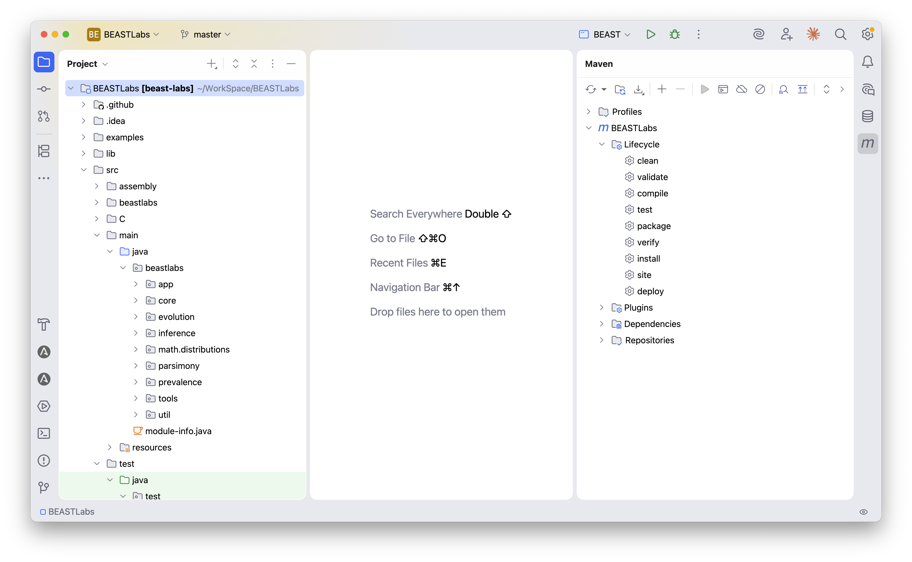

[](https://github.com/BEAST2-Dev/BEASTLabs/actions/workflows/ci-publish.yml)

# BEASTLabs

BEAST utility library containing generally useful classes used by other BEAST packages.

## Building

Requires Java 25 and Maven.

```bash
mvn compile
```

BEAST 3 dependencies (`beast-base`, `beast-pkgmgmt`, `beast-fx`) are resolved from Maven Central,
so no extra repository or token is needed.

To run the tests and build the BEAST package ZIP (`target/BEASTLabs.v<version>.zip`):

```bash
mvn verify
```

## Running an example

Run BEAST on an example XML with BEASTLabs from `target/classes`:

```bash
mvn compile exec:exec -Dbeast.args="-overwrite -prefix target/ examples/testScript.xml"
```

`-prefix target/` writes the log, trees and state files to `target/` instead of the project root.

## Module

JPMS module name: `beast.labs`

Key exports:
- `beastlabs.core.util` — `Slice`, `ParameterConstrainer`
- `beastlabs.util` — `Script`, `Transform`
- `beastlabs.math.distributions` — `BernoulliDistribution`, `WeightedDirichlet`, `WeibullDistribution`
- `beastlabs.evolution.tree` — `RNNIMetric`, `RobinsonsFouldMetric`, `MonophyleticConstraint`
- `beastlabs.evolution.likelihood` — `ExperimentalTreeLikelihood`, `MultiPartitionTreeLikelihood`
- `beastlabs.evolution.operators` — tree operators, `CombinedOperator`
- `beastlabs.parsimony` — Fitch parsimony implementations

## BEAST 3 migration

The `master` branch targets BEAST 3 (`beast-base` 2.8.0-rc1); all 142 source files compile against it.

Changes from BEAST 2:
- Maven build (was Ant)
- JPMS module `beast.labs` with `requires static` for beast-fx/javafx
- `commons-math` 2.x replaced with `commons-statistics` (immutable distribution API)
- `cern.colt.Arrays` replaced with `java.util.Arrays`
- `org.json` replaced with `beast.base.internal.json`
- Nashorn scripting (`beastlabs.util.Script`) via the standalone `nashorn-core` (removed from the JDK);
  nashorn and its ASM dependencies are shipped in the package `lib`, and nashorn is `requires static`
  so BEASTLabs still loads without it. Nashorn also needs the JDK module `jdk.dynalink`,
  which the BEAST launcher must add with `--add-modules`
- Tests use JUnit 5
- BEAST package metadata in `version.xml`
- CI in `.github/workflows/ci-publish.yml`: builds and tests on push and pull request,
  and publishes to Maven Central on a `v*` tag (see [RELEASING.md](RELEASING.md))
- `release.sh` builds the package ZIP and optionally creates a GitHub release

## IntelliJ

It should look like this after following the developer guide https://github.com/CompEvol/beast3/blob/master/scripts/DevGuideIntelliJ.md

<a href="./IntelliJ.png"></a>

